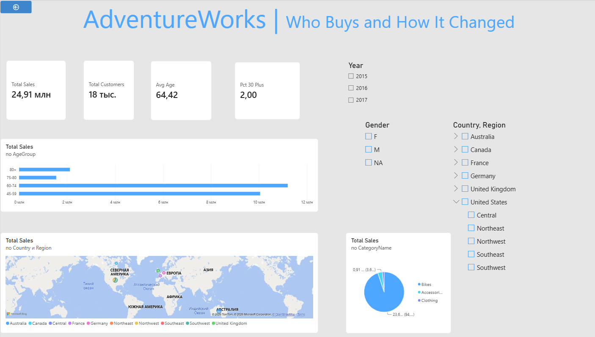

# AdventureWorks: Портрет покупателя

## Задача
Понять, **кто** покупает продукцию AdventureWorks (возраст, пол) и как аудитория менялась за 2015–2017. Ответить на вопросы: стабильно ли ядро 30+, растёт ли молодёжь, какие сегменты и страны дают основную выручку.

## Данные
AdventureWorks — схема «звезда»:
- AdventureWorks_Calendar (таблица дат)
- AdventureWorks_Customers(клиенты), AdventureWorks_Product_Categories(категории продуктов), AdventureWorks_Products(продукты)
- AdventureWorks_Sales_2015 (заказы в 2015)
- AdventureWorks_Sales_2016 (заказы в 2016)
- AdventureWorks_Sales_2017 (заказы в 2017)

Источник: [Kaggle](https://www.kaggle.com/datasets/ukveteran/adventure-works)
Данные за 2015–2017.

## Инструменты
- **Power BI** — дашборд: KPI, bar по возрастам, line по годам, карта

## Что сделано
1. Создала меры в Power BI: `Total Sales`, `Total Customers`, `Avg Age`, `Pct 30 Plus`.
2. Рассчитала возраст клиента и возрастные группы (18–29, 30–44, 45+).
3. Собрала дашборд: 4 KPI-карточки, bar по возрастным группам, line «доля 30+ по годам», карта продаж по странам, 3 слайсера (год, пол, страна).

## Ключевые инсайты

## Инсайт 1: Женщины 60-74 — самый ценный сегмент
Женщины 60-74 дают 50,2% выручки — то есть покупают чаще/дороже среднего. Мужчины того же возраста — 49,1% выручки.

## Инсайт 2: География сконцентрирована в двух странах
США и Австралия дают 61% выручки; на остальные страны — 38%.

## Ограничения
- Возраст рассчитан **на текущую дату**, а не на дату заказа — для исторической точности нужен возраст на момент покупки.
- Выручка рассчитана как `OrderQuantity × UnitPrice`; скидки не учтены (колонка DiscountAmount отсутствует в загруженной версии).
- `New Customers` упрощён (без даты первой покупки).

## Скриншот дашборда

## Структура репозитория
- `powerbi/` — интерактивный дашборд
- `images/` — скриншоты
- `insights.md` — расширенные выводы